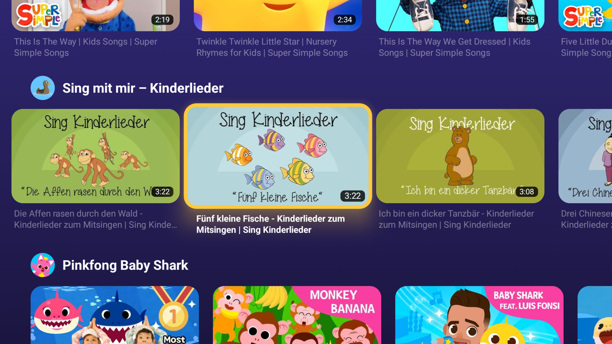
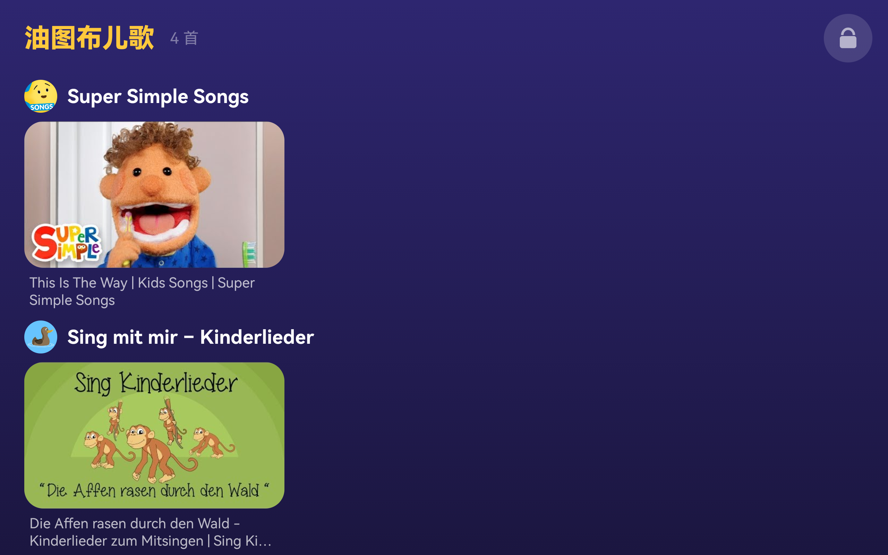

<p align="center"></p>

# 油图布儿歌 · Oil Painting Canvas

这是我给自己家两岁的孩子做的儿歌播放器。它有两个版本：投影仪 / 安卓电视版让孩子用遥控器自己选歌；平板版会提前把儿歌下载好，带出门不用网也能看。界面上只有一排排大封面，不认字也能选；只出现家长挑过的儿歌频道，没有广告、搜索框、评论和推荐。

A nursery-song player I made for my toddler. The projector / Android TV version lets a two-year-old pick songs with the remote; the tablet version downloads songs in advance so they play anywhere without internet. Big covers only, parent-curated Chinese, English and German kids channels, no ads, no search, no comments, no recommendations. Videos are fetched through [Invidious](https://invidious.io).

<p align="center"></p>

## 为什么做它

孩子两岁左右开始喜欢看儿歌，可直接用 YouTube 给这么小的孩子看，我一直不太放心：首页的推荐停不下来，广告时不时插进来，一不小心就点到了不适合的内容。我想要的其实很简单——只放我挑过的几个儿歌频道，孩子自己就能选，不会乱跑出去，也不需要认字。

所以就有了油图布儿歌。它的界面和用法沿用了我之前在电脑上用的「油图布」，但从头为电视和平板重新写了一遍。

## 投影仪 / 电视版

在投影仪上，孩子只需要遥控器的上下左右和 OK 键。打开就是一排排大封面：最上面是「最喜欢」，下面每排一个儿歌频道，按最受欢迎的顺序排列。选中的封面会放大、加一圈黄框，孩子一眼就知道自己选到了哪首。播完会自动接同一排的下一首。播放中按 OK 暂停或继续，左右键后退或快进 10 秒，返回键回到选歌页，并且停在刚才那首歌上。在选歌页按返回键不会退出程序——孩子乱按的时候，我不希望一下子就跑到别的地方去。

家长的操作都藏在 ≡ 键里：短按把当前的歌加入或移出「最喜欢」；长按约 1 秒打开家长设置。设置页会显示一个二维码，用手机扫一下就能打开管理页，在手机上粘贴频道链接或按名字搜索频道，也可以删除、排序、调清晰度，比用遥控器打字方便得多。

投影仪开着、又没在放视频的时候，它会在后台把推荐的歌（先「最喜欢」，再每个频道轮流）存到投影仪上，最多 4 GB，一开始放视频就自动暂停，不跟正在播的视频抢网速。网络不好时，可以进「离线模式」看这些存好的歌。管理页上还能看到每首歌用了什么编码、有没有卡过，方便我排查问题。

<p align="center">
  
  
</p>

### 关于播放稳定性

投影仪的硬件差别很大，我在这上面花的心思比预想的多。它会优先选择 H.264 编码，因为几乎所有投影仪都能硬件解码 H.264；而 AV1 和 VP9 在很多投影仪上只能靠软件解码，常常出现声音还在走、画面却卡住不动的情况。为此我加了一个「画面卡住」检测：声音在走、画面却 3 秒没动时，自动降到 720p 从原来的位置接着放，还卡就改用 360p。播放出错时，也会从原位置接着放，而不是从头开始；断网时会自动改放已经存好的歌。看过的歌会留在 4 GB 的缓存里，再看时几乎立刻就能开始。缓存是按视频的格式和文件版本识别的，所以 Invidious 返回的下载地址变了，也不会重复下载。

## 平板版

平板主要是带出门给孩子用的，外面的网络时好时坏，所以平板版换了一种思路：在家连着 WiFi 时，把儿歌提前下载到平板上；出门后只放已经存好的歌，完全不需要网络。它和投影仪版是两个独立的安装包，可以装在同一台设备上。

<p align="center"></p>

打开应用后，下载会自动开始：先下「最喜欢」，再在各个频道之间轮流取歌，每个频道最受欢迎的歌先下。这样不管下到哪一步，每个频道都已经有歌可看。每首歌保存 720p 画面，并尽量把字幕一起下载下来：先找频道语言的字幕，没有就找中文，再没有就找英文，人工字幕优先于自动生成的。如果插了内存卡，歌会存在卡上，最多 128 GB，每个频道取最受欢迎的前 300 首左右；存满就停。下载会同时进行很多首，每个文件分成小段下载，卡住的连接会自动重连，家长设置里能看到实时速度。每 6 小时，它会看看频道有没有出新歌。

为了不偷偷用掉手机流量，平板版只在家里这种不计流量的 WiFi 下载，连着手机热点或移动数据时不会下载。

孩子看到的界面很简单：顶部有「中文 / English / Deutsch」三个大按钮，下面是一排排大封面，只显示已经存好的歌。点一下就全屏播放，播完自动接下一首。播放时轻点屏幕，会出现返回、上一首、暂停、下一首、「字」（字幕开关）和 ❤ 几个大按钮。进度条我特意做成只能看、不能拖，免得孩子一不小心把视频拖到别处。家长设置藏在右上角的小锁里，要按住 2 秒才能进去。

有一件事我要特别说明：在华为平板上，熄屏几分钟后系统会冻结应用，下载就停了，这一点应用自己绕不过去。所以我做了一个「夜间下载」模式：插着电、开着油图布、还有歌没下完时，屏幕会保持亮着；1 分钟没人碰，就变成全黑、亮度最低的画面，只留一行进度小字。睡前插上电、打开油图布放着就可以了。

### 视频服务器

视频列表和视频地址都通过 Invidious 获取。公共 Invidious 服务器是志愿者自费维护的，这一两年越来越不容易用了，我自己也因为请求发得太猛，被一台公共服务器封过一次 IP（经过写在 [v1.9 的说明](docs/release-notes/v1.9.md)里）。所以平板版支持登记多个服务器，当前的出了问题会自动换下一个；家长设置里也可以给每台服务器测速，一键选出最快的。

如果你和我一样，平板是在家里连电脑的热点下载，我很推荐在这台电脑上自建一个只给自己用的 Invidious。我的做法是用 podman 跑三个容器：`invidious`、`invidious-companion`（它能自己生成 YouTube 要求的 PO Token，儿童内容也能正常获取）和 `postgres`，交给 systemd 开机自启，每天自动更新镜像。有两个配置特别容易出错：companion 的 `public_url` 要填平板能访问到的地址；电脑的防火墙要对热点放行这两个服务的端口。完整的经过和踩过的坑，都写在 [v2.2 的说明](docs/release-notes/v2.2.md)里。

## 默认频道

这些都是我逐个核对过的官方频道，可以在家长设置里随意增删：

- **中文**：宝宝巴士、碰碰狐 Pinkfong 简体中文、Bebefinn 简体中文、贝乐虎儿歌、CoComelon 中文版、儿歌多多、小宝贝布姆、小伊普童谣
- **English**：Super Simple Songs、Pinkfong Baby Shark、Little Baby Bum、CoComelon、Mother Goose Club、Bounce Patrol、Dave and Ava、Hey Bear Sensory
- **Deutsch**：Sing mit mir、Kinderlieder zum Mitsingen und Bewegen、Hurra Kinderlieder、CoComelon Deutsch、Pinkfong Baby Hai、Little Baby Bum Deutsch、Lichterkinder、Volker Rosin、Rolf Zuckowski、KiKAninchen

## 安装

到 [Releases](../../releases) 下载最新版本。每个版本都有两个安装包：`oil-painting-canvas-pad-*.apk` 是平板版，`oil-painting-canvas-*.apk` 是投影仪 / 电视版。

**平板**：把 apk 传到平板上直接点开安装；或者在平板上打开 USB 调试，连上电脑后运行 `./install.sh pad`。

**投影仪 / 电视**，任选一种方式：

- **U 盘**：拷到 U 盘，插到投影仪上，用文件管理器打开安装
- **WiFi**：投影仪打开「开发者选项 → USB 调试 / 网络调试」，然后在电脑上运行
  ```
  ./install.sh 投影仪的IP地址
  ```

支持安卓 6.0 及以上的设备。

## 自己编译

需要 JDK 17 以上和 Android SDK（compileSdk 37）。

```
echo "sdk.dir=$HOME/Android/Sdk" > local.properties
./gradlew assembleTvRelease    # 投影仪 / 电视版：app/build/outputs/apk/tv/release/app-tv-release.apk
./gradlew assemblePadRelease   # 平板版：app/build/outputs/apk/pad/release/app-pad-release.apk
```

两个版本放在同一个项目里，用 Gradle 的 product flavor 区分：核心的歌单、缓存和离线播放代码在 `app/src/main`，平板专用的部分在 `app/src/pad`，投影仪专用的部分在 `app/src/tv`。用到的技术有 Kotlin、Jetpack Compose、AndroidX Media3 ExoPlayer（DASH 播放和缓存）、OkHttp、Coil 和 ZXing。所有数据都只保存在设备本地。

## 版本

每个版本具体做了什么、为什么这么做、中间走过哪些弯路，我都尽量写在了 [Releases](../../releases) 里（也保存在 [docs/release-notes](docs/release-notes)）。

| 版本 | 内容 |
|---|---|
| [v2.3](../../releases/tag/v2.3) | 修复平板版下载跑一阵后变成一次只下一首 |
| [v2.2](../../releases/tag/v2.2) | 自建私有服务器、服务器测速；修复字幕误判等四个问题 |
| [v2.1](../../releases/tag/v2.1) | 多个视频服务器，出问题自动切换 |
| [v2.0](../../releases/tag/v2.0) | 中文分类和 8 个中文儿歌频道、字幕、平板缓存 128 GB |
| [v1.9](../../releases/tag/v1.9) | 控制请求频率（起因是我把一台公共服务器惹到封了我们的 IP） |
| [v1.8](../../releases/tag/v1.8) | 平板版存到内存卡、同时下载 32 首 |
| [v1.7](../../releases/tag/v1.7) | 平板版下载提速，卡住自动重连 |
| [v1.6](../../releases/tag/v1.6) | 平板版只用 WiFi 下载 |
| [v1.5](../../releases/tag/v1.5) | 新增平板版 |
| [v1.4](../../releases/tag/v1.4) | 许可证说明和名称统一（GPL-3.0、英文名 Oil Painting Canvas） |
| [v1.3](../../releases/tag/v1.3) | 「关于 · 免责声明」页面 |
| [v1.2](../../releases/tag/v1.2) | 自动批量缓存和离线模式 |
| [v1.1](../../releases/tag/v1.1) | 修复画面卡住、加 4 GB 视频缓存 |
| [v1.0](../../releases/tag/v1.0) | 第一个版本 |

每个版本的源码都保留在提交历史和标签里。

## 关于 · 免责声明

<p align="center"></p>

**这是什么。** 油图布儿歌是我为自己家孩子做的儿歌播放器。它不是 YouTube 或 Google 的产品，和 YouTube、Google 以及软件里出现的各个儿歌频道都没有任何关系，也没有得到它们的授权或认可。

**软件来源。** 界面和用法沿用了我电脑上用的「油图布」，电脑版基于开源项目 [FreeTube](https://freetubeapp.io)（AGPL-3.0）。电视版和平板版是另外编写的程序，不包含 FreeTube 的代码。视频列表和视频地址都通过开源项目 [Invidious](https://invidious.io)（AGPL-3.0）获取。另外还用到了这些开源软件（均为 Apache-2.0）：AndroidX Media3、Jetpack Compose、OkHttp、Coil、ZXing。没有这些项目，就没有油图布儿歌，真心感谢它们的作者和维护者，尤其是那些自费运营公共 Invidious 服务器的志愿者。

**视频来源与版权。** 所有视频、封面、频道名称和头像都来自 YouTube，版权归原作者和频道所有。本软件不修改、也不重新发布任何视频内容。投影仪版的缓存和平板版下载的歌，都只保存在自己的设备上，供自己家观看。如果你的孩子也喜欢某个频道，请到 YouTube 上关注并支持原作者，是他们做出了这些好内容。

**视频内容仅供个人观看。** 软件本身按 GPL-3.0 开源（见下文「许可证」），但通过它看到和保存的视频属于各自的版权人，只能个人和家庭观看，不得用于商业用途，也不得再传播。绕开广告、不登录观看、把视频保存到设备上，这些做法可能不符合 YouTube 的服务条款。是否使用、如何使用，请自行判断并承担责任。

**隐私。** 不需要账号，也不收集、不上传任何个人信息和使用记录。频道列表、最喜欢、播放记录和视频缓存都只保存在设备上。观看和下载时的网络请求，会发给你所用的 Invidious 服务器和 YouTube 的图片服务器，它们能看到设备的 IP 地址。

**免责声明。** 本软件按现状提供，不提供任何形式的保证。YouTube 或 Invidious 的变化，随时可能让部分或全部功能失效，我会尽力跟进，但无法保证。视频内容由各频道负责，请家长先看过再给孩子看，并尽量陪孩子一起看。

## 许可证 · License

油图布儿歌（Oil Painting Canvas）是自由软件，按 [GNU 通用公共许可证第 3 版（GPL-3.0）](LICENSE) 发布：你可以自由地使用、学习、修改和再分发它；再分发（包括修改后的版本）时，必须同样按 GPL-3.0 开源，并附上源码。本软件不提供任何担保。

This program is free software: you can redistribute it and/or modify it under the terms of the GNU General Public License as published by the Free Software Foundation, version 3. It is distributed WITHOUT ANY WARRANTY. See [LICENSE](LICENSE).

This license covers the app's own source code only. Videos, thumbnails and channel names shown in the app belong to their respective owners on YouTube.
