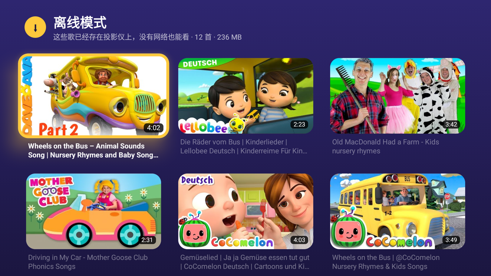
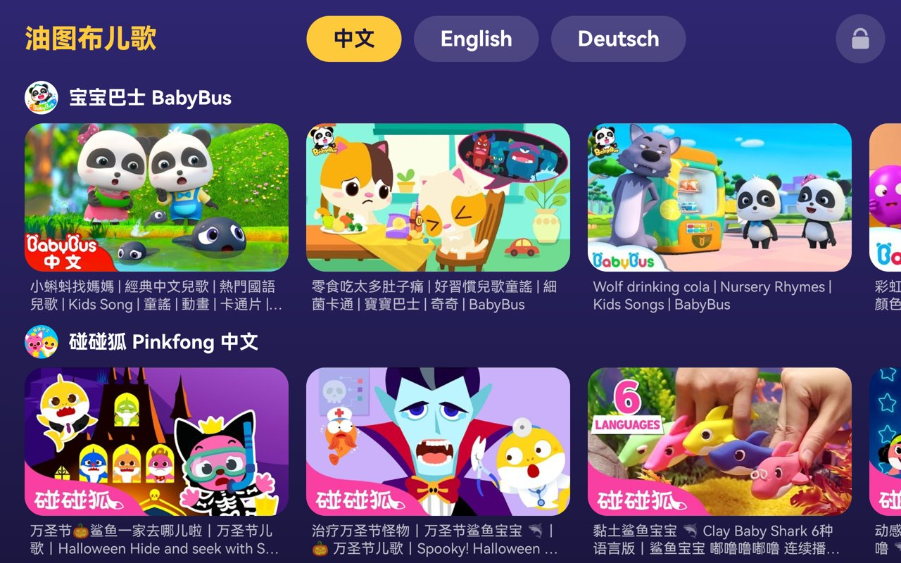
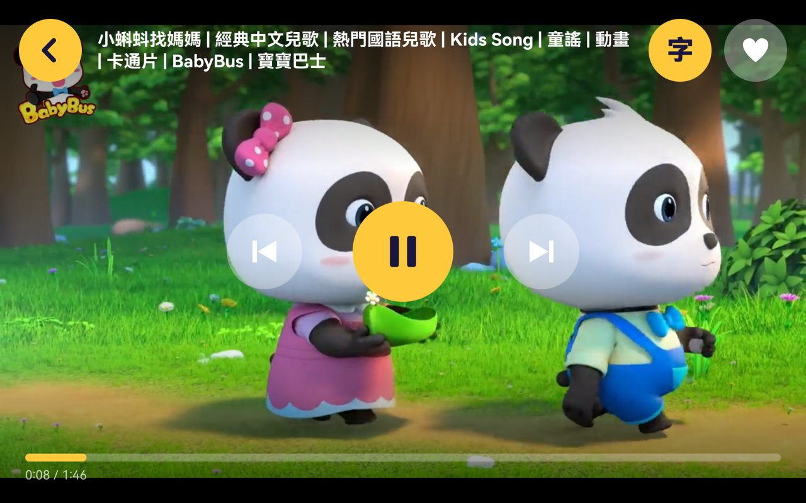
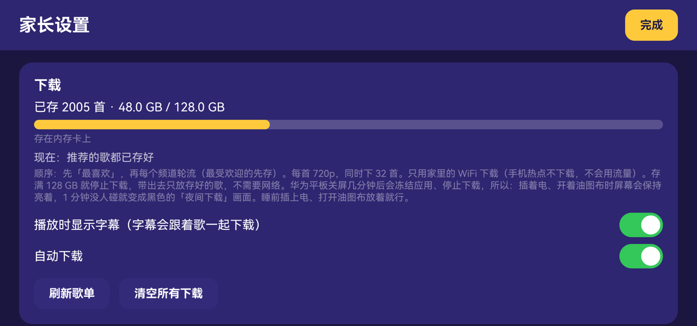

<p align="center"></p>

# 油图布儿歌 · Oil Painting Canvas

给两岁孩子用的儿歌播放器。投影仪 / 电视版用遥控器选歌；平板版提前下载，出门不用网也能看。只有大封面和家长挑过的频道，没有广告、搜索、评论和推荐。

A nursery-song player for toddlers: remote-friendly on projectors / Android TV, fully offline on tablets. Parent-curated Chinese, English and German channels; no ads, search, comments or recommendations. Videos come through [Invidious](https://invidious.io).

<p align="center"></p>

## 投影仪 / 电视版

- 只用方向键和 OK：一排一个频道，「最喜欢」在最上面；播完自动接下一首；选歌页按返回不会退出
- 家长：短按 ≡ 加入 / 移出最喜欢；长按 ≡ 打开设置，手机扫码管理频道
- 空闲时自动缓存推荐的歌（最多 4 GB），没网时可进「离线模式」
- 优先 H.264；画面卡住 3 秒自动降清晰度；出错从原位置继续

<p align="center">
  
  
</p>

## 平板版

在家用 WiFi 提前下载，出门不用网也能看。

<p align="center"></p>

- **中文 / English / Deutsch 分类**，只显示已经存好的歌，点一下全屏播放
- **自动下载**到内存卡，最多 128 GB，同时下 32 首；连手机热点时不下载

<p align="center"></p>

- **大按钮播放页**：返回、上一首、暂停、下一首、❤；「字」开关字幕（字幕跟着歌一起下载）
- 进度条只能看不能拖，防止孩子乱点

<p align="center"></p>

- **家长设置**：按住右上角小锁 2 秒进入；能看下载进度和容量，开关字幕和自动下载，管理频道
- 华为平板熄屏会停止下载：插着电、开着应用即可，没人碰时会自动黑屏并调到最低亮度

<p align="center"></p>

- **视频服务器**：可以登记多个，出问题自动切换；能给每台测速，一键选最快的。公共 Invidious 服务器越来越不稳定，建议在家里电脑上自建一个（`invidious` + `invidious-companion` + `postgres`），做法见 [v2.2 说明](docs/release-notes/v2.2.md)

## 默认频道

- **中文**：宝宝巴士、碰碰狐、Bebefinn、贝乐虎儿歌、CoComelon 中文版、儿歌多多、小宝贝布姆、小伊普童谣
- **English**：Super Simple Songs、Pinkfong Baby Shark、Little Baby Bum、CoComelon、Mother Goose Club、Bounce Patrol、Dave and Ava、Hey Bear Sensory
- **Deutsch**：Sing mit mir、Kinderlieder zum Mitsingen und Bewegen、Hurra Kinderlieder、CoComelon Deutsch、Pinkfong Baby Hai、Little Baby Bum Deutsch、Lichterkinder、Volker Rosin、Rolf Zuckowski、KiKAninchen

## 安装

从 [Releases](../../releases) 下载：`oil-painting-canvas-pad-*.apk` 是平板版，`oil-painting-canvas-*.apk` 是投影仪 / 电视版。直接安装，或用脚本：

```
./install.sh pad            # 平板（USB 调试）
./install.sh 投影仪的IP地址   # 投影仪（网络调试）
```

支持安卓 6.0 及以上。

## 编译

需要 JDK 17+ 和 Android SDK（compileSdk 37）。

```
echo "sdk.dir=$HOME/Android/Sdk" > local.properties
./gradlew assembleTvRelease assemblePadRelease
```

Kotlin、Jetpack Compose、Media3 ExoPlayer、OkHttp、Coil、ZXing。数据只存在设备本地。

## 版本

| 版本 | 重点 |
|---|---|
| [v2.3](../../releases/tag/v2.3) | 修复下载变成一次只下一首 |
| [v2.2](../../releases/tag/v2.2) | 自建服务器、测速；下载 58 MB/s |
| [v2.1](../../releases/tag/v2.1) | 多服务器自动切换 |
| [v2.0](../../releases/tag/v2.0) | 中文分类、字幕、128 GB |
| [v1.9](../../releases/tag/v1.9) | 限制请求频率，避免被服务器封禁 |
| [v1.8](../../releases/tag/v1.8) | 存到内存卡、并行下载 |
| [v1.7](../../releases/tag/v1.7) | 下载提速、卡住自动重连 |
| [v1.6](../../releases/tag/v1.6) | 只用 WiFi 下载 |
| [v1.5](../../releases/tag/v1.5) | 新增平板版 |
| [v1.4](../../releases/tag/v1.4) | 许可证和名称统一 |
| [v1.3](../../releases/tag/v1.3) | 关于 · 免责声明 |
| [v1.2](../../releases/tag/v1.2) | 批量缓存和离线模式 |
| [v1.1](../../releases/tag/v1.1) | 修复画面卡住、4 GB 缓存 |
| [v1.0](../../releases/tag/v1.0) | 第一个版本 |

## 关于 · 免责声明

<p align="center"></p>

- 个人为自家孩子做的软件，与 YouTube、Google 及各儿歌频道无关，未经它们授权或认可。
- 界面沿用电脑版「油图布」（基于 [FreeTube](https://freetubeapp.io)，AGPL-3.0），本项目不含其代码；视频经由 [Invidious](https://invidious.io)（AGPL-3.0）获取；另用到 Media3、Jetpack Compose、OkHttp、Coil、ZXing（Apache-2.0）。感谢这些项目，以及自费运营公共 Invidious 服务器的志愿者。
- 视频、封面和频道名称版权归原作者。缓存和下载的视频只存在自己设备上，仅供家庭观看，不得商用或再传播。绕开广告、免登录、保存视频可能违反 YouTube 服务条款，请自行判断。
- 无需账号，不收集任何个人信息；请求会发给所用的 Invidious 服务器和 YouTube 图片服务器。
- 按现状提供，不作任何保证。请家长先看过内容，再陪孩子一起看。

## 许可证 · License

[GPL-3.0](LICENSE)：可以自由使用、修改和再分发，再分发时须同样开源并附源码。

This program is free software under the GNU GPL v3, WITHOUT ANY WARRANTY. See [LICENSE](LICENSE). The license covers the app's source code only; videos, thumbnails and channel names belong to their owners on YouTube.
