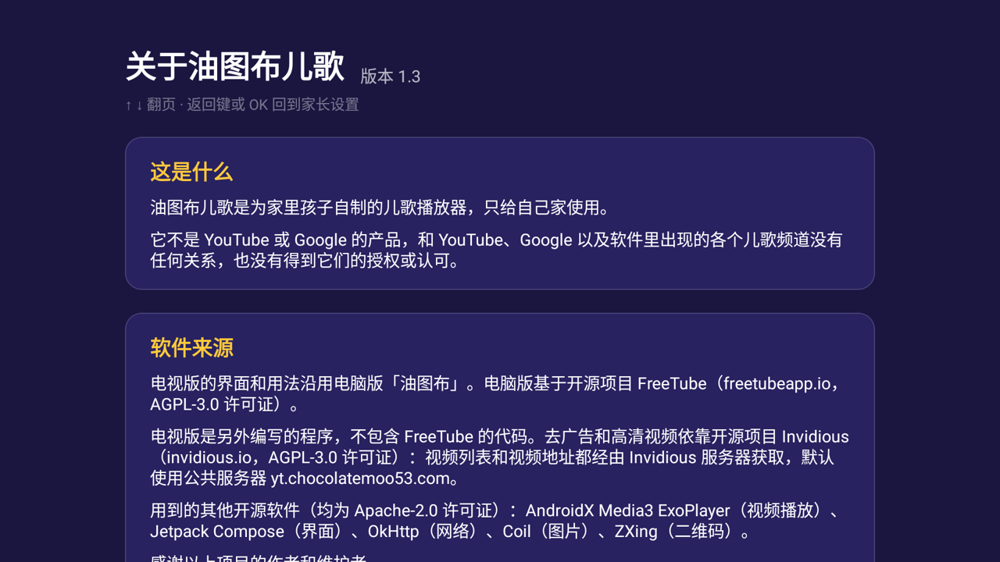

<p align="center"></p>

# 油图布儿歌 · Youtubu Kids TV

给两岁孩子用**投影仪 / 安卓电视遥控器**自己选儿歌的播放器。一排排大封面，不认字也能选；只显示家长挑好的英文和德文儿歌频道，没有广告、搜索框、评论和推荐。

A nursery-song player for Android TV and projectors, made for a toddler who picks songs with the remote. Big covers, parent-curated English and German kids channels, no ads, no search, no comments, no recommendations. Videos are fetched through [Invidious](https://invidious.io).

<p align="center"></p>

## 功能

**孩子用**
- 打开就是一排排大封面：最上面「最喜欢」，下面每排一个儿歌频道，按最受欢迎排序
- 只用上下左右和 OK：选中的封面会放大、加黄框；播完自动放同一排的下一首
- 播放中：OK 暂停/继续，◀ ▶ 后退/快进 10 秒，返回键回到选歌页（停在刚才那首）
- 选歌页按返回键不会退出程序，孩子乱按也不会跑出去
- 「离线模式」：已经存在投影仪上的歌，没有网络也能看

**家长用**
- 短按 ≡：把当前的歌加入/移出「最喜欢」
- 长按 ≡（约 1 秒）：家长设置。手机扫二维码就能打开管理页，粘贴频道链接或按名字搜索频道、删除、排序、调清晰度
- 自动批量缓存：投影仪开着、不放视频时，把推荐的歌（先「最喜欢」，再每个频道轮流）存到投影仪上，最多 4 GB；放视频时自动暂停下载
- 播放记录：管理页上能看到每首歌用的编码、有没有卡住，方便排查问题

<p align="center">
  
  
</p>

**默认频道**（可以在管理页随意增删）：Super Simple Songs、Pinkfong Baby Shark、Little Baby Bum、CoComelon、Mother Goose Club、Bounce Patrol、Dave and Ava、Hey Bear Sensory；Sing mit mir、Kinderlieder zum Mitsingen und Bewegen、Hurra Kinderlieder、CoComelon Deutsch、Pinkfong Baby Hai、Little Baby Bum Deutsch、Lichterkinder、Volker Rosin、Rolf Zuckowski、KiKAninchen。

## 播放稳定性

- 优先使用 H.264 编码：几乎所有投影仪都有它的硬件解码（AV1 / VP9 常常只能软解，会画面卡住、声音继续）
- 画面卡住检测：声音在走但画面 3 秒不动时，自动降到 720p 从原位置接着放，还卡就改用 360p
- 出错时从原位置接着放，不从头重放；断网时自动改放已经存好的歌
- 4 GB 视频缓存：看过的歌再看时几乎立刻开始（缓存按格式和文件版本识别，不受 Invidious 地址变化影响）

## 安装

到 [Releases](../../releases) 下载最新的 `.apk`，然后任选一种方式：

- **U 盘**：拷到 U 盘，插到投影仪上，用文件管理器打开安装
- **WiFi**：投影仪打开「开发者选项 → USB 调试 / 网络调试」，电脑上运行
  ```
  ./install.sh 投影仪的IP地址
  ```

支持安卓 6.0 及以上的电视和投影仪。

## 自己编译

需要 JDK 17 以上和 Android SDK（compileSdk 37）。

```
echo "sdk.dir=$HOME/Android/Sdk" > local.properties
./gradlew assembleRelease
# 安装包：app/build/outputs/apk/release/app-release.apk
```

技术：Kotlin、Jetpack Compose（电视遥控器焦点）、AndroidX Media3 ExoPlayer（DASH 播放和缓存）、OkHttp、Coil、ZXing。所有数据只保存在设备本地。

## 版本

| 版本 | 内容 |
|---|---|
| [v1.3](../../releases/tag/v1.3) | 「关于 · 免责声明」页面 |
| [v1.2](../../releases/tag/v1.2) | 自动批量缓存和离线模式 |
| [v1.1](../../releases/tag/v1.1) | 修复画面卡住、加 4 GB 视频缓存 |
| [v1.0](../../releases/tag/v1.0) | 第一个版本 |

每个版本的源码都保留在提交历史和标签里。

## 关于 · 免责声明

<p align="center"></p>

- **这是什么**：为自己家孩子自制的儿歌播放器。它不是 YouTube 或 Google 的产品，和 YouTube、Google 以及软件里出现的各个儿歌频道没有任何关系，也没有得到它们的授权或认可。
- **软件来源**：电视版的界面和用法沿用电脑版「油图布」，电脑版基于开源项目 [FreeTube](https://freetubeapp.io)（AGPL-3.0）。电视版是另外编写的程序，不包含 FreeTube 的代码；去广告和高清视频依靠开源项目 [Invidious](https://invidious.io)（AGPL-3.0），视频列表和视频地址都经由 Invidious 服务器获取。其他开源软件（均为 Apache-2.0）：AndroidX Media3、Jetpack Compose、OkHttp、Coil、ZXing。感谢以上项目的作者和维护者。
- **视频来源与版权**：所有视频、封面、频道名称和头像都来自 YouTube，版权归原作者和频道所有。本软件不保存、不修改、也不重新发布任何视频内容；离线缓存只临时保存在本机上，供自己家观看。喜欢某个频道，请到 YouTube 上关注并支持原作者。
- **仅限个人、非商业使用**：本软件仅供个人和家庭学习、自用，不得用于任何商业用途，不得出售、出租或公开传播本软件和其中的内容。绕开广告和不登录播放的方式可能不符合 YouTube 的服务条款，是否使用、如何使用，由使用者自行判断并承担责任。
- **隐私**：不需要账号，不收集、不上传任何个人信息和使用记录。频道列表、最喜欢、播放记录和视频缓存只保存在设备上。观看时的网络请求会发给 Invidious 服务器和 YouTube 的图片服务器，它们能看到设备的 IP 地址。
- **免责声明**：本软件按现状提供，不提供任何形式的保证。YouTube 或 Invidious 的变化可能让部分或全部功能随时失效。视频内容由各频道负责，请家长先看过再给孩子看，并陪伴孩子使用。
